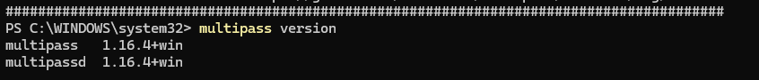
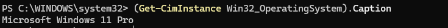
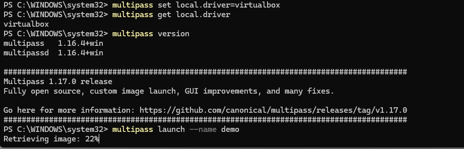
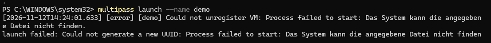
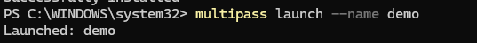
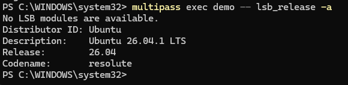
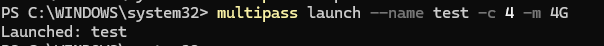
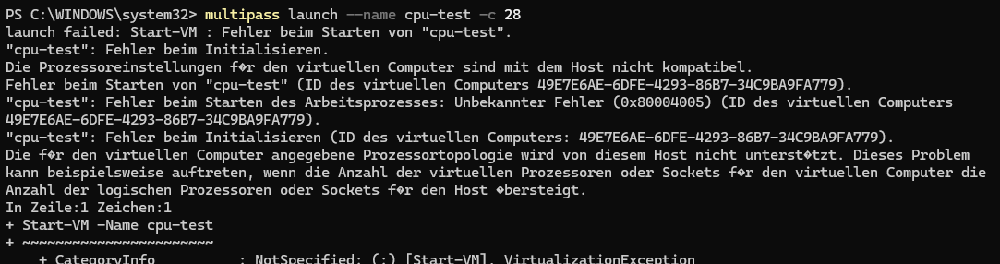
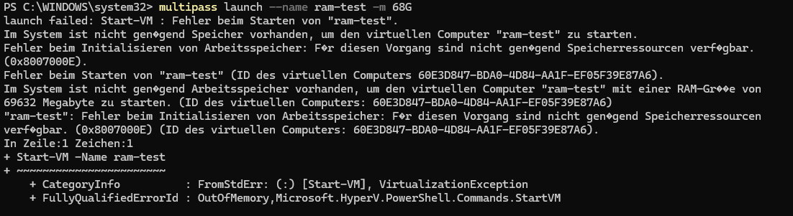
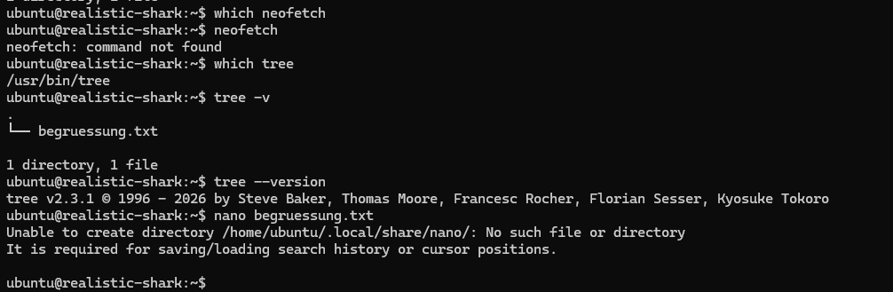

# KN01

## A&B Multipass installieren 

- Multipass per winget installieren

```
winget find multipass
winget install Canonical.multipass
```
- Multipass Version

- Windows Version


- Multipass local driver auf virtualbox setzen
- Multipass localdriver kontrollieren
- Multipass launch demo


- probieren erste VM zu starten: Fail

- Virtualbox fehlt
```
winget find virtualbox
winget install Oracle.VirtualBox
```

- VM erneut starten mit erfolg


- run lsb_release -a inside multipass um die linux version anzuzeigen


- launch mit expliziter cpu/ram/disk angabe


- CPU Test launch mit 28 cpus


- CPU Test launch mit 68Gb ram


- Verwendetes Backend Hyper-V Typ 1, kann nicht Overcommiten

- shell in der VM starten
```
multipass shell demo
```
- Befehl in der VM ausführen ohne login
```
multipass exec demo -- lsb_release -a
```

- Verwalten
```
multipass list                        # alle VMs und ihr Status
multipass info demo                   # Details einer VM (IP, Ressourcen, Disk)
multipass stop demo                   # stoppen
multipass start demo                  # starten
multipass delete demo                 # zum Löschen vormerken ...
multipass purge                       # ... und endgültig entfernen
```

- Mit Optionen erstellen
```
multipass find                                        # verfügbare Ubuntu-Images anzeigen
multipass launch --name kn01 26.04                    # bestimmte Ubuntu-Version
multipass launch --name gross -c 4 -m 4G -d 10G       # 4 CPUs, 4 GB RAM, 10 GB Disk
multipass launch --name auto --cloud-init datei.yaml  # mit cloud-init-Konfiguration
``` 

### Befehls-Spickzettel

| Befehl | Wirkung |
|---|---|
| `multipass launch --name X [Image]` | VM erstellen |
| `multipass launch --cloud-init y.yaml` | VM mit cloud-init erstellen |
| `multipass shell X` | Shell in der VM öffnen |
| `multipass exec X -- <Befehl>` | Befehl in der VM ausführen |
| `multipass list` / `info X` | Übersicht / Details |
| `multipass stop X` / `start X` | stoppen / starten |
| `multipass delete X` + `purge` | löschen (zweistufig) |
| `multipass delete --purge X` | in einem Schritt löschen |
| `multipass find` | verfügbare Images |
| `multipass get local.driver` | verwendetes Backend anzeigen |

## C Launch via cloud-init



"\\wsl.localhost\Ubuntu-24.04\home\csi_local\repos\TBZ\Modul346\KN01\cloud-init-basis.yaml"

